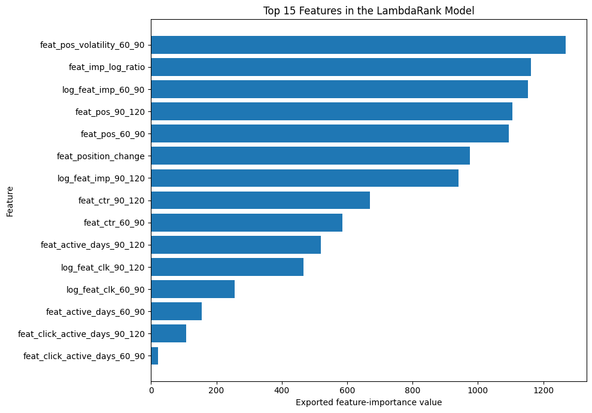
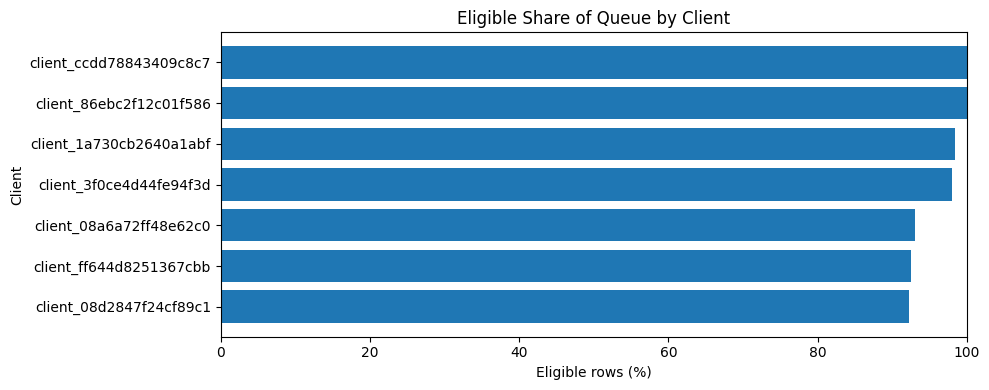
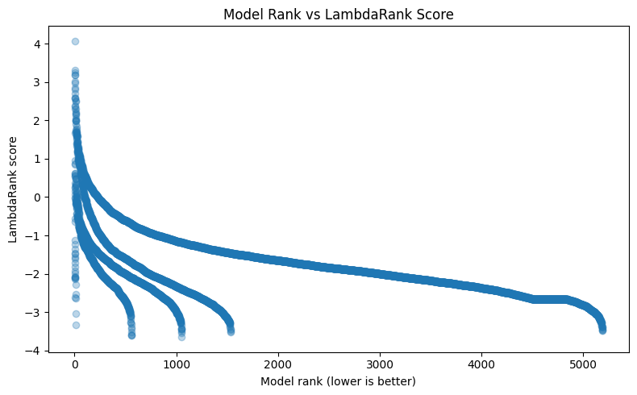
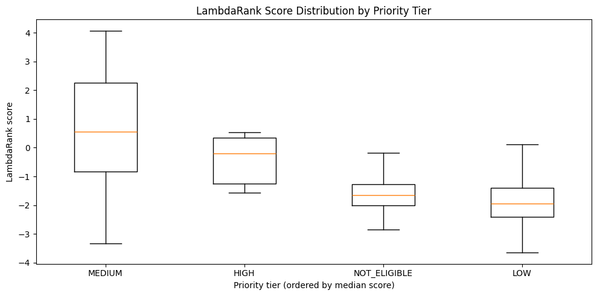
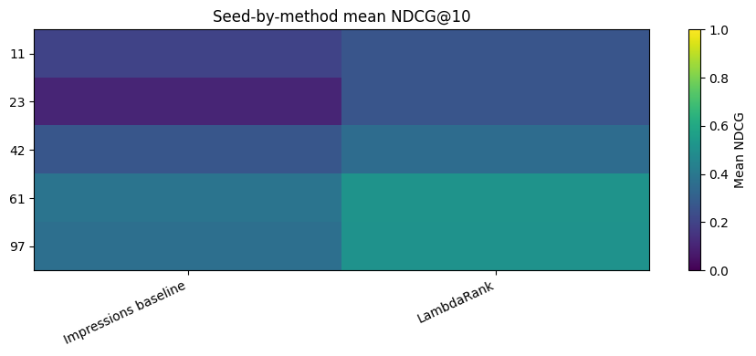
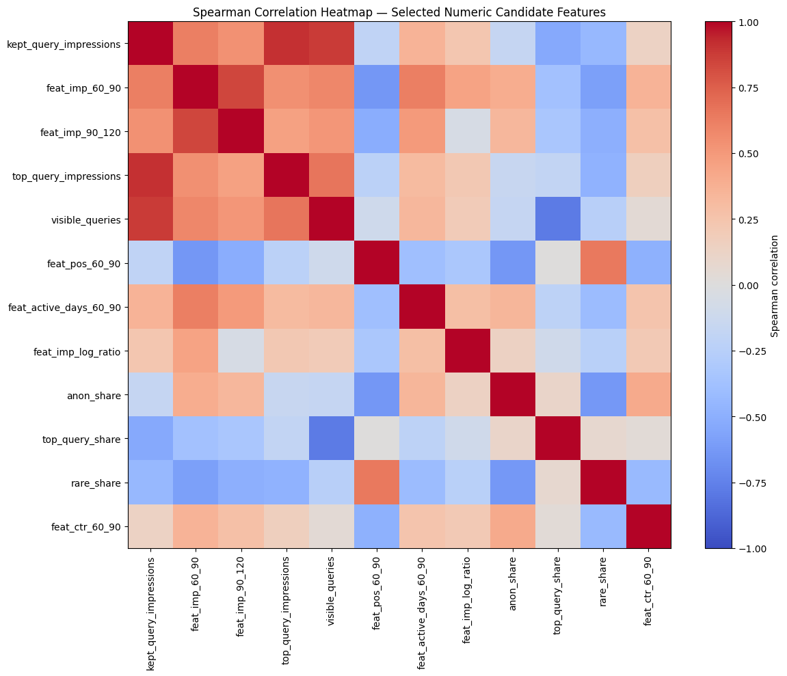
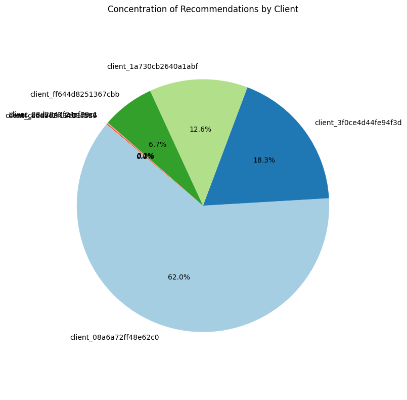
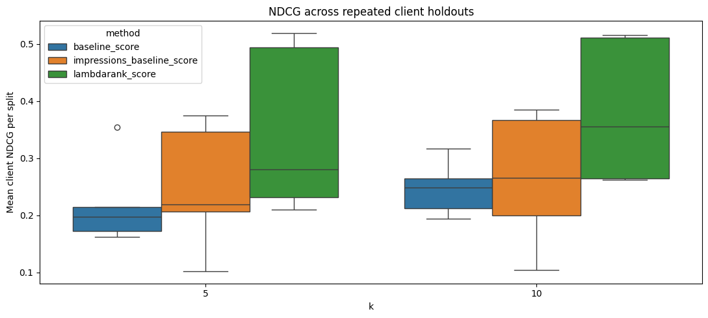
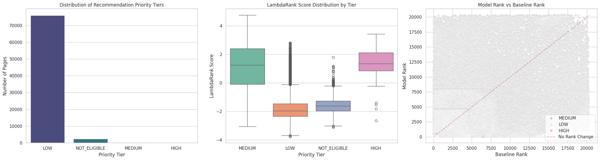
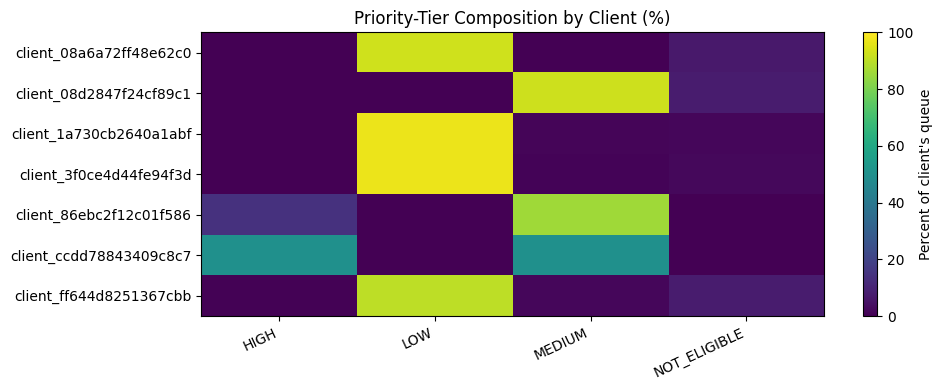

# FlyRank Content Refresh Recommendation Engine

An end-to-end machine-learning project for identifying and prioritizing
content pages that may benefit from a refresh. The project combines
data-quality auditing, transparent recommendation signals,
learning-to-rank evaluation, business-impact tracking,
production-readiness checks, and exploratory data analysis (EDA) of the
exported results.

> **Important interpretation note:** The engine prioritizes pages using
> historical search-performance signals. Ranking quality against
> historical relevance labels is not the same as predicting the causal
> traffic uplift a refresh will produce. Business impact requires real
> interventions and appropriate comparison designs.

## Project goals

-   Build a reliable, auditable content-refresh recommendation workflow.
-   Preserve the distinction between missing Google Search Console (GSC)
    measurements and genuine zero values.
-   Compare a learned ranking model against transparent baselines.
-   Evaluate ranking quality across clients and repeated splits.
-   Produce a recommendation queue with traceable evidence and
    consistent model artifacts.
-   Track actual refresh interventions and observed outcomes when they
    become available.
-   Inspect exported CSV results with reproducible visualizations and
    data-quality diagnostics.

## Project stages

### Stage 1 --- Data validation and transparent recommendation baseline

**Purpose:** Establish the data foundation and create an interpretable
baseline recommendation workflow before relying on a learned ranker.

Main areas covered: - Aggregate search-performance and demand signals
using DuckDB. - Attach optional content metadata and validate join
keys. - Build transparent recommendation signals and priority tiers. -
Audit missing values, feature quality, score ranges, and tier
consistency. - Generate recommendation reasons and suggested actions. -
Inspect high-priority recommendations and review results across
clients. - Export a baseline recommendation queue.

**Key validation questions** - Are client-content keys and joins
valid? - Are missing measurements represented as missing rather than
silently converted to zero? - Are scores and priority tiers internally
consistent? - Can a content editor understand why a page was
recommended?

### Stage 2 --- Learning-to-rank recommendation engine

**Purpose:** Develop and evaluate a machine-learning ranker while
retaining meaningful baselines and evidence-based eligibility rules.

Main areas covered: - Audit GSC availability, missing measurements, and
duplicate keys. - Build coverage-aware training examples. - Engineer
stable trend features and review CTR missingness. - Join available
content metadata and query signals. - Define model features and
transparent benchmark methods. - Evaluate across client-level splits and
repeated split seeds. - Compare LambdaRank with an impressions-only
baseline and a rule-based baseline using NDCG@5 and NDCG@10. - Define
recommendation eligibility using available evidence. - Train a final
ranker and export model artifacts and recommendation results.

**Evaluation interpretation** - NDCG measures the quality of the ranking
against the chosen historical relevance labels. - Client-level and
repeated-split results help reveal whether performance varies
substantially across clients or split configurations. - The learned
ranker should be compared with baselines; a higher overall mean alone
does not establish that it wins for every client. - Repeated
observations from the same client are dependent and should not be
treated as independent samples when estimating uncertainty.

### Stage 3 --- Business-impact and intervention tracking

**Purpose:** Record what happens after recommendations are reviewed and
pages are actually refreshed.

Main areas covered: - Export a recommendation queue and an editable
intervention log. - Track actions such as `not_reviewed`, `accepted`,
`rejected`, `deferred`, `refreshed`, and `no_change`. - Require a real
refresh date for records marked as refreshed. - Summarize observed pre-
and post-refresh GSC measurements when sufficient coverage exists. - Use
observed metric availability and minimum observation requirements rather
than treating absent measurements as zero. - Provide an optional
matched-control / difference-in-differences analysis to compare
refreshed pages with comparable non-refreshed pages.

**Important limitation:** Pre/post changes and difference-in-differences
estimates are observational. Their interpretation depends on valid
treatment records, adequate measurements, suitable controls, and
assumptions about comparability. They should not be presented as
guaranteed causal impact.

If no real refresh events have been recorded, the intervention analysis
should be skipped or report that there is not yet enough data. Do not
invent refresh dates or mark pages as refreshed when they were not.

### Stage 4 --- Production readiness and monitoring

**Purpose:** Add checks around the consistency and operational readiness
of the recommendation workflow.

Areas include: - Validate required artifacts and feature definitions. -
Check output schema, keys, scoring, and eligibility. - Keep the model
bundle, feature definitions, run manifest, and recommendation snapshot
aligned. - Review the production queue and monitoring requirements. -
Separate evaluation outputs from production inference outputs.

**Critical production rule:** The final ranker must score the full
eligible production population, not only the held-out test split.
Held-out rows are for evaluation; they are not a substitute for
production inference. The exported queue should be checked for
population coverage, uniqueness, eligibility, and valid scores before
release.

### EDA --- Analysis of recommendation-engine outputs

The EDA notebook analyzes the CSV artifacts exported by Stage 2. It
reuses the loaded data frames and creates tables and visualizations to
help interpret model performance, recommendation distribution, and data
quality.

Current input files include:

-   `flyrank_stage2_1_ctr_missingness_audit.csv`
-   `flyrank_stage2_1_feature_importance.csv`
-   `flyrank_stage2_1_gsc_coverage_audit.csv`
-   `flyrank_stage2_1_heldout_recommendation_queue.csv`
-   `flyrank_stage2_1_ndcg_per_client_split.csv`
-   `flyrank_stage2_1_ndcg_summary.csv`
-   `flyrank_stage2_1_split_diagnostics.csv`

The EDA includes:

1.  **Recommendation queue overview** --- inspect queue shape, fields,
    and recommendation counts.
2.  **Priority-tier visualization** --- understand how recommendations
    are distributed across tiers.
3.  **LambdaRank score and rank diagnostics** --- inspect scores and
    positions.
4.  **NDCG evaluation** --- review overall ranking metrics.
5.  **Client-level variability** --- investigate differences across
    clients.
6.  **Feature importance** --- inspect the features reported as
    influential by the model.
7.  **GSC coverage and CTR missingness** --- understand measurement
    availability and missingness.
8.  **Split diagnostics** --- inspect evaluation split composition.
9.  **Client-by-client model comparison** --- compare LambdaRank with
    the impressions-only and rule-based baselines at NDCG@5 and NDCG@10;
    plot paired differences, heatmaps, and largest wins/losses.
10. **Recommendation distribution by client** --- examine volume,
    priority-tier composition, and eligible-page percentages.
11. **Priority-tier and ranking-score diagnostics** --- inspect score
    distributions, rank/score relationships, and
    eligibility-versus-priority consistency.
12. **Robustness across split seeds** --- compare seed-level NDCG
    summaries and heatmaps. Descriptive spread is not automatically a
    confidence interval.
13. **Feature relationships and leakage review** --- calculate numerical
    feature correlations and group features by name. Correlation alone
    cannot prove leakage; feature/label time windows and
    feature-selection code must be inspected.
14. **Recommendation and data-quality audit** --- check identifiers,
    duplicate client-content pairs, invalid scores, ranks, eligibility
    values, and missingness.
15. **Business-facing opportunity analysis** --- when historical
    impressions, clicks, or position fields are available, compare their
    distributions by priority tier and client.

**EDA scope:** The held-out recommendation queue describes the exported
held-out population unless its producing pipeline confirms otherwise. Do
not assume it represents all eligible production pages. EDA charts
summarize historical evidence and ranking behavior; they do not
establish that refreshing a page will cause traffic to increase.


### EDA visual gallery and interpretation

The figures below are exported from the EDA results supplied for this project. They describe the saved analysis outputs; they are not proof of causal refresh uplift. Images are stored in `assets/eda/` so they render directly in GitHub.

#### 1. LambdaRank feature importance



The exported feature-importance values are highest for `feat_pos_volatility_60_90`, followed by impression-trend features such as `feat_imp_log_ratio` and `log_feat_imp_60_90`, then position-related features. This suggests the fitted ranker relies strongly on changes in search visibility/position and impression patterns. The chart's values are the exported importance measure; they should not be interpreted as causal effects or as the direction of a feature's effect. Confirm the meaning of the importance field in the model-export code before comparing it across model runs.

#### 2. Eligible share of the queue by client



For the seven displayed clients, the eligible share is high (roughly 92–100%). This is a within-client percentage, not a measure of each client's share of the total recommendation volume. Because only the clients present in this exported queue are shown, this chart does not establish coverage of every client or of the full production population. The production export should separately verify all eligible pages and clients are scored.

#### 3. Model rank versus LambdaRank score



The scatter shows a strong monotonic ordering pattern: better (lower-numbered) ranks tend to have higher scores, while scores generally decline as rank numbers increase. Multiple curved bands likely reflect separate client/query groups or ranking groups in the exported data; validate grouping keys before interpreting the bands. Rank is ordinal, and the absolute score scale is model-specific, so score differences should not be read as calibrated probabilities.

#### 4. LambdaRank score distribution by priority tier



The displayed MEDIUM group has a higher and wider score distribution than the other shown tiers; HIGH is lower in this particular chart, while LOW and NOT_ELIGIBLE are mostly negative. This is a diagnostic, not necessarily a defect: priority tiers may be generated by a separate rule-based eligibility/evidence system rather than by directly thresholding LambdaRank scores. Confirm the intended tier logic and ensure that production eligibility rules—not score sign alone—control whether a page can be recommended.

#### 5. Seed-by-method mean NDCG@10



Across the displayed seeds, LambdaRank appears to outperform the impressions baseline on mean NDCG@10 for several seeds, with variation across seeds. The heatmap is useful for spotting sensitivity to split choice. Read it alongside paired client-level results and the complete NDCG distributions; seed-level means alone do not show whether every client benefits, and repeated observations should not be treated as independent.

#### 6. Feature correlation and potential redundancy



The heatmap shows strong positive associations among several impression/query-volume features, including `kept_query_impressions`, `top_query_impressions`, and `visible_queries`, as well as associations among related impression trend features. Position, rare-query, and top-query-share features show different relationships. Correlation can indicate overlapping information or redundancy, but it does not by itself prove leakage. Leakage review must inspect the feature construction windows and ensure all features are available before the outcome/label period.

#### 7. Recommendation concentration by client



The pie chart indicates that the displayed recommendation rows are concentrated in a small number of clients, with one client contributing about 62% and another about 18% in this snapshot. Tiny slices are difficult to compare in a pie chart; use a sorted bar chart and report counts alongside percentages for clearer diagnosis. This is a statement about the exported snapshot only, not necessarily the production population or the underlying client portfolio.

#### 8. NDCG across repeated client holdouts



The boxplots show the distribution of mean client NDCG values for the baseline methods and LambdaRank at \(k=5\) and \(k=10\). LambdaRank has a higher median and a broad spread in the displayed results, while baseline performance is lower on these plots. The broad spread indicates meaningful variation across splits/clients. Report sample counts and paired differences as well as medians; do not infer statistical significance from overlapping or non-overlapping boxplots alone.

#### 9. Combined EDA dashboard



This three-panel overview combines (left) priority-tier counts, (middle) score distributions by tier, and (right) model rank versus baseline rank. The tier-count panel is dominated by LOW and NOT_ELIGIBLE rows, with comparatively few HIGH/MEDIUM rows. The middle panel helps inspect score separation by tier. In the rank comparison, points far from the diagonal indicate pages whose order differs between the learned model and baseline; the axes and legend should be checked to confirm which method's rank is on each axis. The plot is heavily overplotted, so use a sample, density plot, or rank-change distribution for more readable comparisons.

#### 10. Priority-tier composition by client



The heatmap compares the percentage of each displayed client's queue assigned to HIGH, LOW, MEDIUM, and NOT_ELIGIBLE. The mix differs markedly across clients: some are mostly LOW, while others have a larger MEDIUM or HIGH share. This can reflect differences in site performance, data coverage, and the eligibility rules. Inspect raw counts as well as percentages, because small client queues can produce extreme percentages from only a few pages.

#### Cross-chart conclusions

- **LambdaRank is a promising ranking candidate** in the shown evaluation summaries, but retain baseline comparisons and per-client/split diagnostics before production adoption.
- **Trend and position features are prominent** in the exported feature-importance chart; audit their time windows to rule out leakage and document the feature definitions.
- **Queue composition varies by client**, and the recommendation snapshot appears concentrated in a small number of clients. Verify whether this is caused by the held-out export, eligibility filters, sampling, or incomplete production scoring.
- **Priority tier and model score are not interchangeable.** Validate the documented tier/eligibility rules independently of the model score.
- **These figures do not demonstrate refresh uplift.** Business impact requires valid intervention records and appropriately designed outcome comparisons.

## Data and technology

The workflow uses: - **Python** for data preparation, modeling,
evaluation, and visualization. - **Pandas / NumPy** for analysis. -
**DuckDB** for analytical SQL and querying Parquet data. - **Hugging
Face Datasets** as the warehouse location for the full-release data. -
**scikit-learn** utilities for splitting, preprocessing, and evaluation
support. - **Learning-to-rank / LambdaRank** as the leading ranking
approach evaluated against baselines. - **Matplotlib** for EDA
visualizations. - **Google Colab** for notebook execution and Google
Drive-based artifact access.

The full-release workflow uses the `FlyRank/internship-warehouse`
dataset and a Hugging Face access token configured through Colab Secrets
or an environment variable. **Never commit access tokens, credentials,
or private client data to GitHub.**

## Repository and notebook organization

Notebook filenames may differ between working and final drafts. A
suggested organization is:

``` text
.
├── assets/
│   └── eda/                 # EDA figures embedded in this README
├── notebooks/
│   ├── stage1_data_validation_and_baseline.ipynb
│   ├── stage2_learning_to_rank.ipynb
│   ├── stage3_business_impact_tracking.ipynb
│   ├── stage4_production_readiness.ipynb
│   └── recommendation_engine_eda.ipynb
├── outputs/
│   ├── stage2/
│   ├── stage3/
│   └── stage4/
├── models/
├── data/
│   └── raw/
├── requirements.txt
└── README.md
```

This is a suggested layout for publishing the project, not a claim that
the working files already use these exact paths. Adjust the structure to
match the repository before committing.

## Running the EDA notebook in Google Colab

1.  Upload the final EDA notebook to Google Colab.
2.  Mount Google Drive.
3.  Place the exported CSV files in a folder accessible from the
    notebook.
4.  Update the CSV paths in the import cell if your Drive folder
    differs.
5.  Run the import cell to create the seven data frames.
6.  Run the notebook from top to bottom so all summary tables and
    visualizations are produced.

Example CSV loading pattern:

``` python
import pandas as pd

DATA_DIR = (
    "/content/drive/MyDrive/Colab Notebooks/"
    "FlyRank_MachineLearning/flyrank_csv_recommendation_engine"
)

df_ctr_missingness = pd.read_csv(
    f"{DATA_DIR}/flyrank_stage2_1_ctr_missingness_audit.csv"
)
df_feature_importance = pd.read_csv(
    f"{DATA_DIR}/flyrank_stage2_1_feature_importance.csv"
)
df_gsc_coverage = pd.read_csv(
    f"{DATA_DIR}/flyrank_stage2_1_gsc_coverage_audit.csv"
)
df_heldout_queue = pd.read_csv(
    f"{DATA_DIR}/flyrank_stage2_1_heldout_recommendation_queue.csv"
)
df_ndcg_per_client = pd.read_csv(
    f"{DATA_DIR}/flyrank_stage2_1_ndcg_per_client_split.csv"
)
df_ndcg_summary = pd.read_csv(
    f"{DATA_DIR}/flyrank_stage2_1_ndcg_summary.csv"
)
df_split_diagnostics = pd.read_csv(
    f"{DATA_DIR}/flyrank_stage2_1_split_diagnostics.csv"
)
```

The notebook checks for recognized column names in several analyses. If
a section reports that a field is unavailable, inspect the CSV's actual
columns and update the mapping rather than assuming the analysis ran.


------------------------------------------------------------------------

*Project documentation should be updated whenever the notebook logic,
exported schemas, model features, or production workflow changes.*
